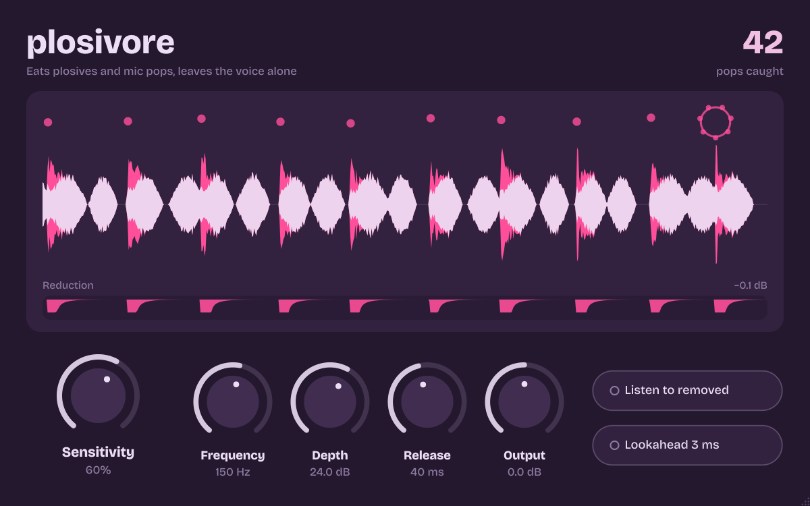

# Plosivore

A plosive and mic-pop remover for vocals. It listens for the low thump of a "p", "b" or a
breath hitting the capsule, turns down only that thump for only as long as it lasts, and
leaves the rest of the voice alone. Built for fast rap, works on any vocal.



- **Formats:** VST3 (Windows, macOS, Linux), Audio Unit (macOS), standalone app. AAX for Pro Tools when built with Avid's SDK (see below).
- **Latency:** zero by default. Optional 3 ms lookahead, reported to your DAW so tracks stay aligned.
- **CPU:** about 0.6% of one core for a stereo track at 48 kHz.
- **Mono or stereo.** Stereo channels are linked so the image never wobbles.

## Using it

Put it first on the vocal chain, before compression (a compressor will happily make pops louder).

| Control | What it does |
|---|---|
| **Sensitivity** | How readily a low thump counts as a pop. Start at 60%. Raise it if pops slip through; lower it if deep, bassy words get thinned. |
| **Frequency** | Pops below this are removed (60–300 Hz). 150 Hz suits most voices. Lower it for very deep voices, raise it for harsh capsule thumps. |
| **Depth** | The most a pop can be turned down. 24 dB removes pops completely; 10–15 dB just tames them. |
| **Release** | How quickly the low end comes back after a pop. 20–40 ms for fast rap, 60–120 ms for slow, sung vocals. |
| **Output** | Level trim. |
| **Listen to removed** | Hear only what's being taken out. You should hear thumps, never words. |
| **Lookahead 3 ms** | Catches the very first instant of each pop. Adds 3 ms latency; leave it off while recording. |

Double-click any knob to reset it. Click the pop counter to reset the count.

### Reading the display

- The pale waveform is your vocal after Plosivore. Anything **pink** behind it is what was removed, so pink should only appear at pops.
- Each caught pop blows a **pink bubble** that bursts and leaves a dot, so you can see where pops landed over the last three seconds.
- The **Reduction** lane underneath shows how hard each pop was turned down.

## Installing

### Mac: use the installer

Open **Plosivore-1.0.0-macOS.dmg** and double-click **Install Plosivore**. It installs, for all users:

| Part | Installed to | For |
|---|---|---|
| VST3 plugin | `/Library/Audio/Plug-Ins/VST3/` | Ableton Live, FL Studio, Cubase, Studio One, Reaper, Bitwig |
| Audio Unit | `/Library/Audio/Plug-Ins/Components/` | Logic Pro, GarageBand |
| Standalone app | `/Applications/` | Using it without a DAW |

All three are selected by default; click **Customize** on the Installation Type step to pick. Running it again upgrades cleanly. To remove everything, double-click **Uninstall Plosivore** on the same disk image.

**If macOS says the installer "can't be opened"** (it will, unless you've set up Apple signing below): click **Done**, open **System Settings > Privacy & Security**, scroll down to the message about Install Plosivore, and click **Open Anyway**. You only need to do this once per download. Plugins put in place by the installer don't get blocked afterwards.

### Windows and Linux

Download the zip for your system (see *Getting the plugin* below), copy `Plosivore.vst3` into your plugin folder, then rescan in your DAW.

| System | VST3 folder |
|---|---|
| Windows | `C:\Program Files\Common Files\VST3\` |
| Linux | `~/.vst3/` |

Pro Tools needs AAX (see below).

## Getting the plugin

### Easiest: let GitHub build it (no coding tools needed)

1. Create a new repository on GitHub and upload this whole folder (including the hidden `.github` folder).
2. Open the repository's **Actions** tab. A build starts automatically and takes about 10 minutes.
3. When it finishes, open the run and download from *Artifacts*: **Plosivore-macOS-Installer** (the Mac installer), **Plosivore-Windows** or **Plosivore-Linux**.

Every build is checked with [pluginval](https://github.com/Tracktion/pluginval) at its strictest level before it's packaged. Push a tag such as `v1.0.0` and everything, including the Mac installer, is also published as a GitHub Release.

### Mac installer with no security warning (optional)

Apple only lets an installer open without the *Open Anyway* step if it's signed with an Apple Developer ID and notarised by Apple. That needs a paid Apple Developer Program membership. Once you have it, add these as repository secrets (**Settings > Secrets and variables > Actions**) and every build will be signed and notarised automatically:

| Secret | What it is |
|---|---|
| `MACOS_CERTS_P12` | Your *Developer ID Application* and *Developer ID Installer* certificates exported together from Keychain Access as a .p12, then base64-encoded (`base64 -i certs.p12 \| pbcopy`) |
| `MACOS_CERTS_PASSWORD` | The password you set when exporting the .p12 |
| `MACOS_DEV_ID_APPLICATION` | e.g. `Developer ID Application: Joe Bloggs (AB12CD34EF)` |
| `MACOS_DEV_ID_INSTALLER` | e.g. `Developer ID Installer: Joe Bloggs (AB12CD34EF)` |
| `APPLE_ID` | The Apple ID email on your developer account |
| `APPLE_TEAM_ID` | Your 10-character team ID |
| `APPLE_APP_PASSWORD` | An app-specific password from appleid.apple.com |

To build the installer on your own Mac instead: build the plugin (below), then run `bash Installer/macOS/sign_plugins.sh build/Plosivore_artefacts/Release` and `bash Installer/macOS/build_pkg.sh build/Plosivore_artefacts/Release installer`.

### Building on your own computer

You need CMake 3.22+ and a C++17 compiler (Xcode on macOS, Visual Studio 2022 on Windows). JUCE is downloaded automatically.

```
cmake -S . -B build -DCMAKE_BUILD_TYPE=Release -DPLOSIVORE_COPY_AFTER_BUILD=ON
cmake --build build --config Release
```

`PLOSIVORE_COPY_AFTER_BUILD=ON` installs the plugin into your system plugin folders when the build finishes.

### Pro Tools (AAX)

AAX plugins need Avid's free AAX SDK (from an Avid developer account), and Pro Tools only loads them once they're signed with PACE's tools, which Avid arranges for registered developers. With the SDK downloaded:

```
cmake -S . -B build -DCMAKE_BUILD_TYPE=Release -DAAX_SDK_PATH=/path/to/aax-sdk
```

## How it works

Plosives and capsule pops are bursts of very low-frequency air energy that arrive far louder than the voice above them. Normal speech and rap keep those two in balance, even on deep voices.

1. Each channel is split into three bands with phase-matched Linkwitz-Riley crossovers that sum back flat: **low** (below Frequency), **chest** (Frequency to 2.2× Frequency) and **voice** (everything above).
2. A fast detector compares low-frequency level against the voice. It also measures how suddenly the low end jumped, so held low notes and bassy close-miked voices aren't mistaken for pops.
3. When the low end jumps well above the voice, the low band is turned down hard (up to Depth) and the chest band by half as much, which is where the "body" of a pop bleeds through. The voice band is never touched, so consonants stay crisp.
4. Reduction holds briefly through the pop's slow cycles, then releases.

The DSP lives in `Source/PlosiveEngine.h` as plain C++ with no framework dependency.

## Test results

Measured with the scripts in `Tests/` on a synthetic 14-second vocal: fast rap from deep and high voices at 7–9 syllables per second with 42 planted pops (breath plosives and capsule thumps), plus a held low sung passage with no pops. Default settings.

| Measure | Result |
|---|---|
| Pops detected | 42 of 42, no false counts |
| Pop low-end energy removed | 19 dB median, 9 dB in the hardest case |
| Pop peak level reduced | 17 dB median |
| Change to the vocal away from pops | −36 to −38 dB relative to the vocal (inaudible) |
| Change to held low notes | −105 dB (untouched) |
| False triggers on a bass-heavy, close-miked vocal | none at 60% sensitivity |

To rerun: `python3 Tests/make_test_audio.py <dir>`, build `Tests/run_engine.cpp` with any C++17 compiler, then `python3 Tests/score.py <dir>`.

## Project layout

```
Source/PlosiveEngine.h      detection + band processing (plain C++)
Source/PluginProcessor.*    parameters, latency reporting, feed to the display
Source/PluginEditor.*       interface
Resources/                  Bricolage Grotesque font (SIL Open Font License, see Font-OFL.txt)
Tests/                      test-vocal generator, offline runner, scoring, UI snapshot tool
Installer/macOS/            Mac installer: packaging + signing scripts, pages, artwork, uninstaller
.github/workflows/build.yml automatic macOS / Windows / Linux builds
```
